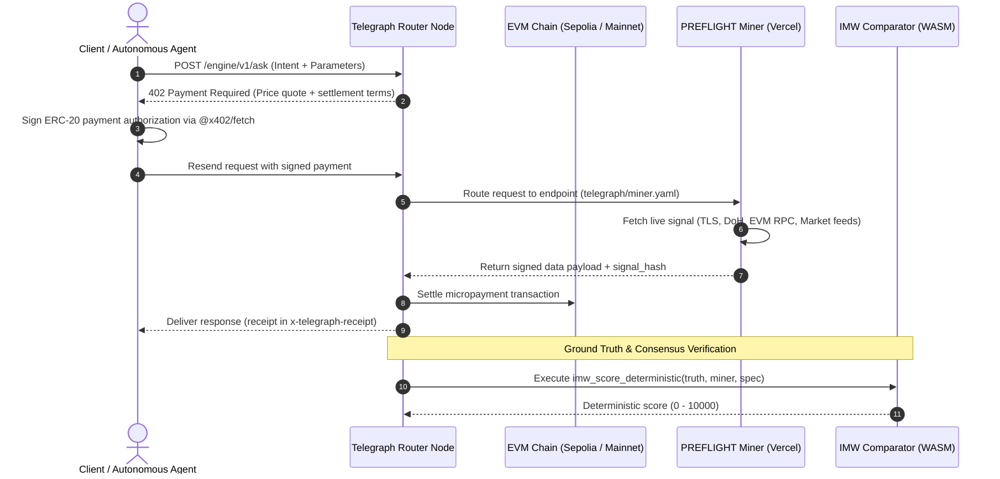

# preflight-miner-config

Public, commit-pinned home of the **PREFLIGHT** miner manifest (`telegraph/miner.yaml`) for Telegraph Protocol registrations. 

The Telegraph node fetches this manifest from an immutable `raw.githubusercontent.com/<owner>/<repo>/<commit>/telegraph/miner.yaml` URL and verifies its SHA-256 against the on-chain registry hash. Because of this cryptographic guarantee, the manifest is preserved here byte-for-byte.

* **Miner ID:** `20260828` (`a1-preflight`)
* **Registration:** `#377`
* **On-Chain Manifest SHA-256:** `4d96099c1f52cb3d2a31733b75f5a5040946038fa8109cb2cd08c622a2a04f02`
* **Live Service Base URL:** `https://preflight-ssl-verification.vercel.app`

---

## Architecture & System Overview

PREFLIGHT serves as a high-integrity oracle and deterministic signal provider for autonomous systems across web infrastructure, decentralized finance (DeFi), and cross-chain networks.

### High-Level Data & Settlement Flow

---

## Core Components

| Component | Path | Description |
|---|---|---|
| **Miner Manifest** | [`telegraph/miner.yaml`](telegraph/miner.yaml) | Declarative mapping of ~3,300 lines defining supported intents, REST endpoints, parameter schemas, circuit breakers, and rate limits. |
| **Scoring Modules** | [`comparator/`](comparator/) | Compiled WebAssembly modules (`wasm32-unknown-unknown`) implementing zero-import deterministic scoring rules for consensus rounds. |
| **Agent Example** | [`examples/first-paid-agent/`](examples/first-paid-agent/) | Minimal 90-line autonomous buyer agent using `@x402/fetch` on Sepolia test USDC to purchase and cross-verify infrastructure signals. |

---

## Supported Signal Families

* **TLS / Infrastructure Health:** Real-time TLS certificate handshake verification (chain trust, hostname matching, expiry dates) and multi-phase latency probing.
* **DNS Verification:** Independent Dual-resolver DNS-over-HTTPS (DoH) lookups.
* **On-Chain Reads:** State reads, gas prices, token total supplies, and account balances across 16+ EVM chains (Ethereum, Base, Arbitrum, Optimism, Polygon, BNB Chain, Avalanche, Linea, Scroll, Gnosis, zkSync, Blast, Mantle, Celo, Sonic, Unichain).
* **Deterministic Scoring (IMW):** Embedded WASM evaluators supporting Exact (Code 0), Absolute Tolerance (Code 1), Relative Tolerance (Code 2), and Pass/Fail (Code 3).

---

## Tutorials & Examples

* [Your first paid agent on Telegraph, in 90 lines](examples/first-paid-agent/README.md): Pay per request, inspect response structures, verify market specifics, ask for secondary opinions, and execute fail-safe holding patterns.
